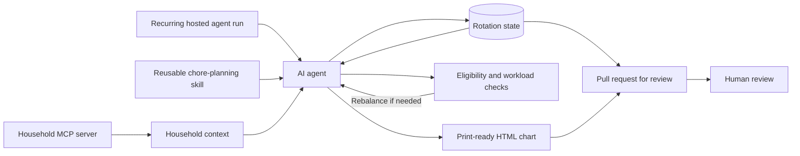

# Fair Chore Rotation

**Author:** Steve Doroff · **Showcase prepared:** October 25, 2026

A portfolio showcase of an AI agent workflow built to address a household problem: recurring chores were not being shared evenly.

The system combines an agent skill, household context from an MCP server, persistent rotation state, workload checks, and a print-ready HTML chart. It is designed to make expectations explicit and assignments reviewable, not to claim that a schedule can settle every question of fairness.

## The problem

A simple round-robin can still be unfair. People may not be eligible for the same tasks, and equal task counts do not necessarily mean equal effort. The workflow carries rotation positions forward, checks task counts and estimated effort, and applies a documented rebalance when needed.

## How it fits together

The skill describes the workflow and its constraints. The MCP server supplies household context. A separate state file carries rotation positions and assignment history. The agent generates the chart and proposes state changes in a pull request, so the result can be reviewed before it is adopted.

The original workflow was iterated on locally over months before recurring hosted runs were introduced. This showcase does not include the hosted-run configuration or connect to a live MCP server.

## Technical design

- **Agent skill:** Encodes the sequence of work, eligibility handling, balance checks, rebalance procedure, and output requirements.
- **MCP context:** Provides household information to the agent through the Model Context Protocol. Household context and rotation policy have distinct roles.
- **Persistent state:** Tracks each task's rotation position and recent assignments so the next run can continue from the prior one.
- **Constraint checks:** Evaluates task counts and estimated effort, while respecting eligibility and task-specific rules.
- **Human review:** Presents generated HTML and state changes in a pull request rather than silently replacing the prior version.
- **Print output:** Produces a browser-friendly chart with print styles for a practical household handoff.

## Showcase contents

| Path | Purpose |
|---|---|
| [`skill/chore-planning.md`](./skill/chore-planning.md) | Sanitized, illustrative version of the agent skill |
| [`docs/architecture.md`](./docs/architecture.md) | System boundaries, data flow, and implementation notes |
| [`examples/rotation-state.md`](./examples/rotation-state.md) | Synthetic rotation state and workload check |
| [`examples/weekly-chart.html`](./examples/weekly-chart.html) | Synthetic print-ready chart |

All names, tasks, dates, assignments, and effort estimates in the examples are invented for demonstration. They do not describe an actual household.

## Scope and limitations

This is a **portfolio showcase, not a runnable application**. It contains no live household data, credentials, MCP server implementation, hosted-agent configuration, or local setup instructions. The examples explain the design without promising that a standalone clone will reproduce the original environment.

The balancing process uses estimated effort and explicit rules. It can make assumptions visible and assignments more consistent, but it cannot determine whether every estimate is accurate or whether every household considers a result fair.

## Review focus

When reviewing this project, look at how the workflow:

1. Separates household context, persistent rotation state, and assignment policy.
2. Handles fairness as more than equal task counts.
3. Turns exceptions into explicit, reviewable rules.
4. Produces a human-readable artifact and a reviewable change.
